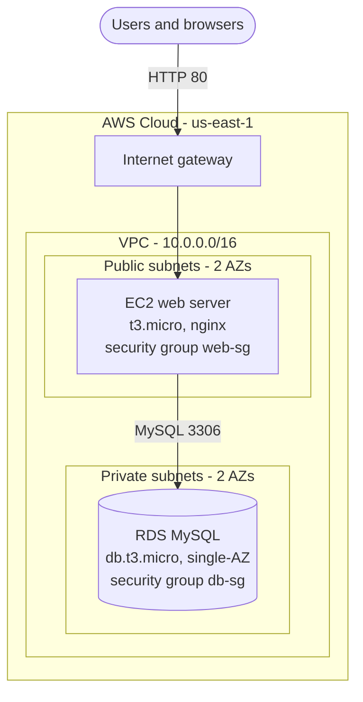

# Three-tier app on AWS

A small, low-cost three-tier application on AWS: a public web tier, a private database tier, and a VPC that keeps them apart. It is built for learning and avoids the NAT Gateway to keep the monthly bill small.

## Architecture



## The three tiers

| Tier | AWS service | Where it runs | Reachable from |
|------|-------------|---------------|----------------|
| Presentation | EC2 (`t3.micro`) with nginx | Public subnet | The internet, on port 80 |
| Application | Same EC2 instance | Public subnet | Behind the web server |
| Data | RDS MySQL (`db.t3.micro`, single-AZ) | Private subnet | The web server only, on port 3306 |

The application tier shares the EC2 instance with the web tier to keep costs down. To split them later, add a second EC2 instance (or a Lambda function) between the web server and the database.

## Network and security

| Security group | Inbound rule | Source |
|----------------|--------------|--------|
| `web-sg` | HTTP, port 80 | Anywhere (0.0.0.0/0) |
| `db-sg` | MySQL, port 3306 | `web-sg` only |

- The database has no public address and cannot be reached from the internet.
- There is no SSH access. The web server is managed through AWS Systems Manager Session Manager (the instance role has `AmazonSSMManagedInstanceCore`).
- There is no NAT Gateway (about $30 a month). The database never needs the internet, and the web server uses the internet gateway.
- The VPC has a free S3 gateway endpoint.
- Two availability zones are used for the subnets because an RDS subnet group requires them, even though the database itself runs in one zone.

## Deploy it (console steps)

Use a non-root IAM admin user with MFA, in `us-east-1`.

1. **VPC:** VPC and more. CIDR `10.0.0.0/16`, 2 AZs, 2 public and 2 private subnets, NAT gateways **None**, S3 gateway endpoint on.
2. **Security groups:** create `web-sg` (inbound HTTP 80 from anywhere) and `db-sg` (inbound MySQL 3306 from `web-sg`).
3. **RDS:** create a DB subnet group from the two private subnets. Create a MySQL `db.t3.micro` instance, single-AZ, 20 GiB gp3, storage autoscaling off, **public access: No**, security group `db-sg`.
4. **IAM role:** create an EC2 role with `AmazonSSMManagedInstanceCore`.
5. **EC2:** launch Amazon Linux 2023 on a `t3.micro` in a public subnet with a public IP, security group `web-sg`, the SSM role, no key pair, and this user data:

```bash
#!/bin/bash
dnf install -y nginx mariadb105
systemctl enable --now nginx
echo "<h1>Web tier is up</h1>" > /usr/share/nginx/html/index.html
```

## Verify it

1. Open `http://<web-server-public-ip>`. You should see "Web tier is up".
2. In EC2, select the instance and choose **Connect > Session Manager**. Then connect to the database from the server:

```bash
mysql -h <rds-endpoint> -u admin -p
```

A `mysql>` prompt means the web tier can reach the data tier.

3. From your own computer, the RDS endpoint should time out. That confirms the database is private.

## Cost notes

- Check **Billing** and run `aws freetier get-free-tier-usage --region us-east-1` regularly.
- A public IPv4 address costs about $0.005 an hour.
- Avoid until needed: NAT Gateway, interface VPC endpoints, Multi-AZ RDS, load balancers.
- Set an AWS Budgets alert and a CloudWatch billing alarm.

## Clean up

Delete in this order, because AWS refuses to delete resources that are in use:

1. Terminate the EC2 instance.
2. Delete the RDS instance (skip the final snapshot if you do not need it), then the DB subnet group.
3. Delete the VPC. This removes its subnets, route tables, internet gateway and endpoint.
4. Delete `web-sg` and `db-sg` if they remain.

Stopping RDS is not a real pause, because AWS starts it again after 7 days. Delete it instead.

## Security notes

- Never commit passwords, access keys, tokens, database endpoints or account IDs.
- Keep MFA on the root user and on the admin IAM user.
