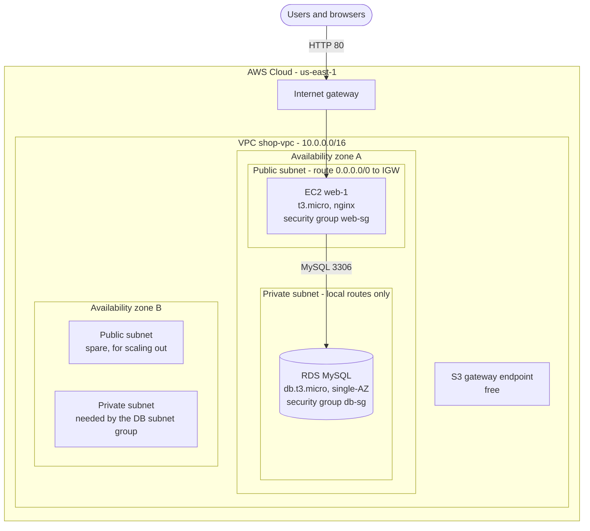

# Architecture

Three-tier app in a VPC: public web tier, private database tier, no NAT gateway.

## Security groups

| Group | Inbound rule | Source |
|-------|--------------|--------|
| web-sg | HTTP, port 80 | Anywhere (0.0.0.0/0) |
| db-sg | MySQL, port 3306 | web-sg only |

## Design choices

- No NAT gateway, which saves about $30 a month. The database never needs the internet.
- The database has no public address, so it is reachable only from the web tier.
- The second availability zone is required by RDS subnet groups and leaves room to add a second web server.
- No SSH. The web server is managed through Session Manager.
